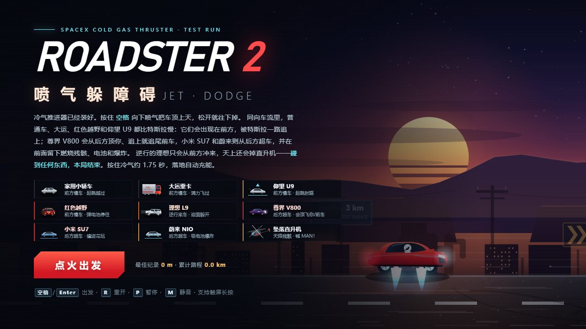
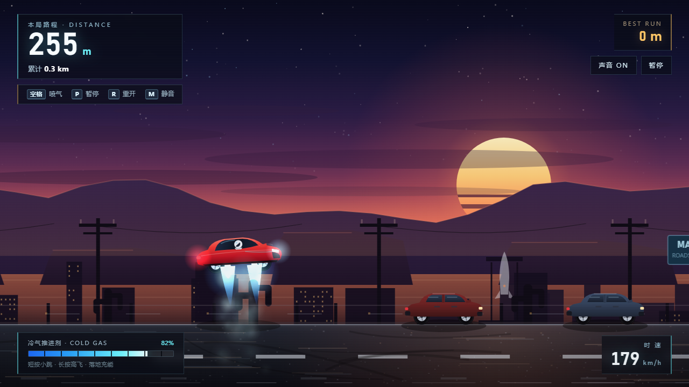
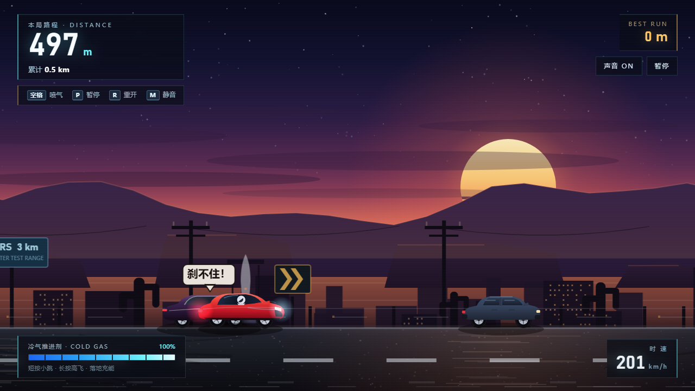
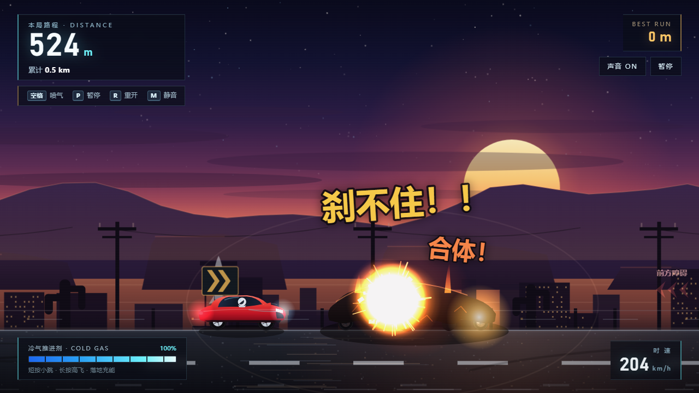
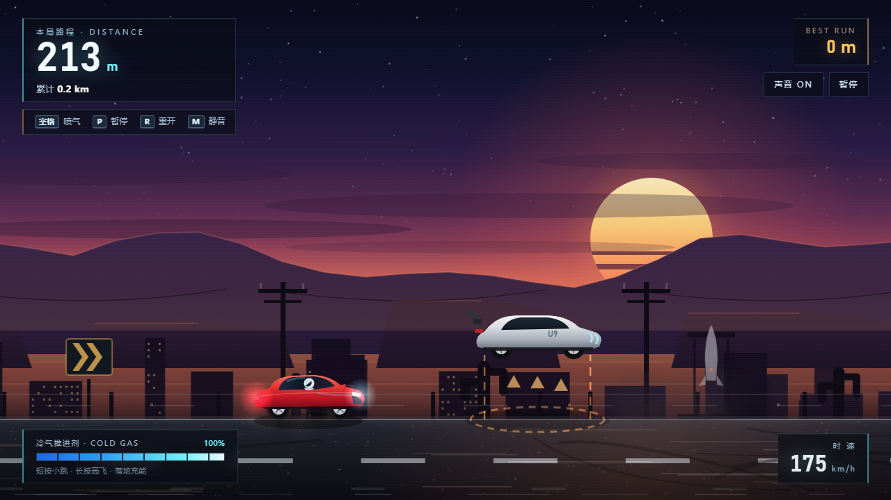
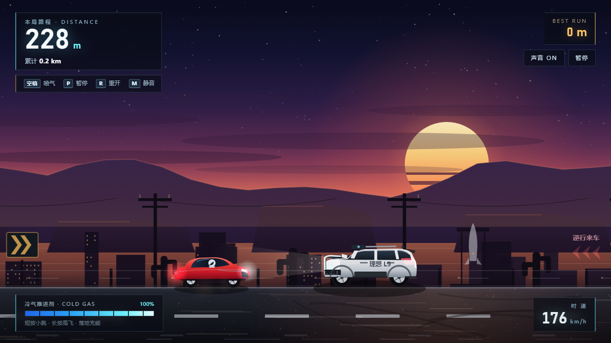

# Tesla Roadster 2 · 喷气躲障碍 / Jet Dodge

**中文** | [English](#english)

一款单文件 HTML5 Canvas 街机小游戏：按住空格向下喷气，把 Roadster 2 顶上天，躲过同向慢车、后方快车、逆行理想、坠落直升机……**碰到任何东西，本局结束。**

A single-file HTML5 Canvas arcade game. Hold **Space** to fire the cold-gas thrusters and leap over slow traffic, fast overtakers, wrong-way SUVs, and falling helicopters. **One touch ends the run.**

[](tesla-roadster2.html)

---

## 中文

### 立即游玩

- **在线试玩（GitHub Pages）**：<https://ilym-expl.github.io/tesla-roadster2/>
- 下载或克隆本仓库，直接双击 **`tesla-roadster2.html`** 即可游玩——无需安装、无需构建、无需联网。
- 单文件约 176 KB，所有美术、音效、代码都在 HTML 内部；不加载任何外部资源。
- 也可以起一个本地静态服务器：`python -m http.server 8000`，然后打开 `http://localhost:8000/tesla-roadster2.html`。

### 玩法

- **按住 `空格` / 长按屏幕**：向下喷气升空；**松开**：自由下落；**落地自动充能**。
- 100% 冷气可连续喷约 **1.75 秒**，单次滞空约 **2.4 秒**，最高点约 528px；推进剂耗尽后只能落地回充，不能空中回气或二段跳。
- 同向车流中，**普通车、大运、红色越野、仰望 U9 比特斯拉慢**，会出现在前方，需要起跳越过。
- **尊界 V800、小米 SU7、蔚来 NIO 比特斯拉快**，会从后方超车：V800 会先顶你、躲过后再追尾前车；SU7 会撞进花坛；NIO 会吸走越野车弹出的电池并造成大爆炸。
- **理想 L9 是唯一逆行来车**，从前方迎面冲来；天上还会掉直升机（MAN！）。
- 距离累计计算，最佳纪录与累计里程保存在浏览器 `localStorage` 中；按 `R` 可立即重开。

### 障碍图鉴

| 障碍 | 行为 | 应对 |
| --- | --- | --- |
| 家用小轿车 | 前方慢车 | 起跳越过 |
| 大运重卡 | 前方慢车，车身最高 | 满推力高跳 |
| 红色电动越野 | 前方慢车，会向后弹射电池并刹停 | 跳过电池与车 |
| 仰望 U9 | 前方慢车，接近时起跳封路（地面危险柱） | 必须飞得更高 |
| 理想 L9 | 唯一逆行大型 SUV | 迎面躲开 |
| 尊界 V800 | 后方快车；不升空会被它追尾，躲过后它追尾前车留下燃烧残骸 | 提前升空，随后跳过残骸 |
| 小米 SU7 | 后方超车，撞进路边花坛 | 跳过燃烧残骸 |
| 蔚来 NIO | 后方超车，吸走越野车电池后大爆炸 | 立刻长按升空 |
| 坠落直升机 | 从屏幕右上坠落，坠地爆炸并留下残骸 | 跳过残骸 / 躲开冲击 |

| 场景 |
| --- |
|  |
|  |
|  |
|  |
|  |

### 操作

| 操作 | 按键 |
| --- | --- |
| 喷气升空 | 按住 `空格` / 长按屏幕 / 按住鼠标左键 |
| 开始游戏 | `空格` / `Enter` / 点击「点火出发」 |
| 重新开始 | `R` |
| 暂停 / 继续 | `P` / `Esc` |
| 静音 | `M` |
| 声音开关、暂停 | 右上角 HUD 按钮 |

### 技术细节

- 单文件：HTML + CSS + 原生 JavaScript（无框架、无第三方库、无构建步骤）。
- Canvas 2D 程序化绘制全部车辆、场景、粒子与特效；WebAudio 实时合成音效。
- 设计分辨率 1280×720，自适应缩放并保持 16:9 黑边（letterbox）。
- 使用 `localStorage` 保存最佳距离、累计里程和静音状态。
- 提供调试 API `window.__ROADSTER__`（v3.0.0），便于用无头浏览器做确定性回放、公平性与布局测试。
- 开发过程中使用 headless Chromium/Edge + CDP 做自动化回归（碰撞死因、跳跃窗口、事件阶段、性能、1280/1920/900 布局），并通过独立 QA 与美术审查。

### 浏览器支持

modern Chrome / Edge / Firefox / Safari（支持 Canvas 2D、WebAudio、localStorage）。推荐桌面端全屏游玩；手机浏览器支持长按触屏操作。

### 项目结构

```text
tesla-roadster2.html   # 游戏本体（单文件）
index.html             # GitHub Pages 跳转页
screenshots/           # README 截图
README.md
LICENSE
```

### 免责声明

本项目是粉丝向的玩笑作品，与特斯拉（Tesla）、理想（Li Auto）、蔚来（NIO）、小米（Xiaomi）、华为/尊界、大运等品牌没有任何关联。车辆名称仅用于玩梗与识别，所有美术均为程序化原创绘制。

### 许可

[MIT](LICENSE) © 2026 ilym-expl

---

## English

### Play now

- **Play online (GitHub Pages):** <https://ilym-expl.github.io/tesla-roadster2/>
- Download or clone this repo and open **`tesla-roadster2.html`** in a browser. No install, no build step, no network required.
- One ~176 KB HTML file: all art, audio, and code are inline; no external assets are loaded.
- Or serve it locally: `python -m http.server 8000`, then open `http://localhost:8000/tesla-roadster2.html`.

### Gameplay

- **Hold `Space` / long-press** to fire the downward cold-gas thrusters; **release** to fall; **landing refuels** the tank.
- A full tank burns for about **1.75 s**, giving ~**2.4 s** of airtime and a peak height of ~528 px. No mid-air refuel and no double jump.
- Slow same-direction traffic — **sedan, Dayun heavy truck, red electric off-roader, Yangwang U9** — appears ahead and must be jumped.
- Fast overtakers — **Zunjie V800, Xiaomi SU7, NIO** — come from behind: the V800 can rear-end you if you stay low, then rear-ends the car ahead if you dodge it; the SU7 crashes into the roadside flowerbed; the NIO absorbs the off-roader's ejected battery and detonates in a huge blast.
- The **Li Auto L9 is the only wrong-way vehicle**, charging at you head-on, and a **helicopter falls from the sky** (MAN!).
- Distance is cumulative; best run and total distance are stored in `localStorage`. Press `R` to restart instantly.

### Hazard cheat sheet

| Hazard | Behavior | Counter |
| --- | --- | --- |
| Sedan | Slow traffic ahead | Jump over it |
| Dayun heavy truck | Slow traffic ahead, tallest vehicle | Full-thrust high jump |
| Red electric off-roader | Slow traffic ahead; ejects a battery backward and brakes to a stop | Clear the battery and the car |
| Yangwang U9 | Slow traffic ahead; hops as you close in and seals its lane with a ground danger column | Fly higher |
| Li Auto L9 | The only wrong-way large SUV | Dodge it head-on |
| Zunjie V800 | Fast overtaker from behind; rear-ends you if you don't climb, then rear-ends the car ahead if you do | Lift off early, then clear the burning wreck |
| Xiaomi SU7 | Overtakes from behind and crashes into the flowerbed | Jump the burning wreck |
| NIO | Overtakes from behind, absorbs the off-roader's battery, and detonates | Hold thrust immediately |
| Falling helicopter | Falls from the top-right, explodes on the ground, leaves a wreck | Jump the wreck / avoid the blast |

### Controls

| Action | Key |
| --- | --- |
| Thrust / jump | Hold `Space`, long-press touch, or hold left mouse button |
| Start | `Space` / `Enter` / click **Ignition** |
| Restart | `R` |
| Pause / resume | `P` / `Esc` |
| Mute | `M` |
| Sound & pause | HUD buttons in the top-right corner |

### Technical notes

- Single file: HTML + CSS + vanilla JavaScript. No framework, no third-party libraries, no build step.
- Everything is drawn procedurally with Canvas 2D — vehicles, scenery, particles and effects; sound effects are synthesized with WebAudio.
- Design resolution 1280×720, responsive scaling with 16:9 letterboxing.
- `localStorage` persists best distance, total distance and mute state.
- Exposes a debug API `window.__ROADSTER__` (v3.0.0) for deterministic headless replay, fairness and layout testing.
- Development used headless Chromium/Edge over CDP for automated regression tests (collision causes, jump windows, event phases, performance, 1280/1920/900 layouts), with independent QA and art reviews.

### Browser support

Modern Chrome / Edge / Firefox / Safari (Canvas 2D, WebAudio, localStorage). Desktop fullscreen is recommended; touch long-press is supported on mobile browsers.

### Project structure

```text
tesla-roadster2.html   # the game (single file)
index.html             # GitHub Pages redirect
screenshots/           # README images
README.md
LICENSE
```

### Disclaimer

This is a fan-made parody project, not affiliated with Tesla, Li Auto, NIO, Xiaomi, Huawei/Zunjie, Dayun or any other brand. Vehicle names are used for recognition and jokes only; all artwork is original procedural drawing.

### License

[MIT](LICENSE) © 2026 ilym-expl
